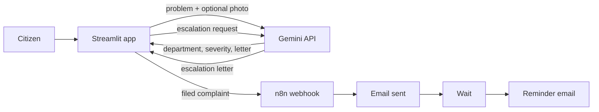

# Forge-26-First-project-
Group name -POWER DUO
participant_1= Sanjana
participant_2= Abhinav
User → Streamlit UI → Gemini (draft + severity + department)
                    → n8n webhook → Email → Wait → Reminder email
                    → Gemini (escalation letter)
## live demo
https://complaintchaser.streamlit.app/

# 📮 Complaint Chaser

> Turn a civic problem into a clear complaint, and follow up until it moves.

**Team POWER DUO** · Forge ’26 (NxtWave Launchpad) · Theme 1: Civic Pulse, Digital Governance & Public Information

🔗 **Live app:** https://complaintchaser.streamlit.app
🎥 **Demo video:** <paste link> · 📊 **Pitch deck:** <paste link>

## The problem
People file a civic complaint (water, garbage, roads, street lights) once, hear nothing back, and give up. Writing a formal complaint in the right words, in the right language, to the right department is hard, and nobody follows up.

**Who it helps:** residents, especially those more comfortable in Telugu or Hindi than in formal English.

## Our solution
Complaint Chaser drafts the complaint, files it, and keeps chasing it.
1. **Describe** the problem (text, optional photo) in plain words.
2. **AI drafts** a formal letter in English, Telugu or Hindi, picks the department, and scores severity (1 to 5) with a reason.
3. **File** it by email through an n8n automation.
4. **Follow up:** n8n waits and sends a reminder automatically.
5. **Escalate:** the AI drafts a firm escalation letter to a senior officer.

**Guardrails:** the AI may only use facts the user gave (placeholders for the rest), asks for details when the input is vague, refuses non-civic input, validates email addresses, and every letter is marked for human review before sending.

## Architecture

<!-- If the MongoDB history ships, add: S --> DB[(MongoDB history)] -->

## Tech stack
Python · Streamlit · Google Gemini API (`google-genai`, with automatic fallback between models) · n8n (webhook, email, wait) · Streamlit Community Cloud · GitHub

## Setup
```bash
git clone https://github.com/sanjana30kavuri-lab/Forge-26-First-project-.git
cd Forge-26-First-project-
python -m venv .venv
.venv\Scripts\activate        # Mac/Linux: source .venv/bin/activate
pip install -r requirements.txt
copy .env.example .env           # then fill in your keys(Mac/linux: cp)
python -m streamlit run app.py
```

| Variable | Purpose |
|---|---|
| `GEMINI_API_KEY` | Google AI Studio key |
| `N8N_WEBHOOK_URL` | Production URL of the n8n webhook |

## n8n workflow
`n8n/complaint-chaser.json` is the exported workflow: Webhook → Send Email → Wait → Reminder Email. Import it in n8n, add your own SMTP credentials, and activate it.

## Limitations and roadmap
- Letters are AI drafts that the user must review.
- Demo emails go to a test inbox, and the wait is shortened for the demo (the ‘skip the 7-day wait’ button is a labelled shortcut).
- Next: department directory, official portal integration, WhatsApp and voice input.

## Team
POWER DUO: <name 1>, <name 2>