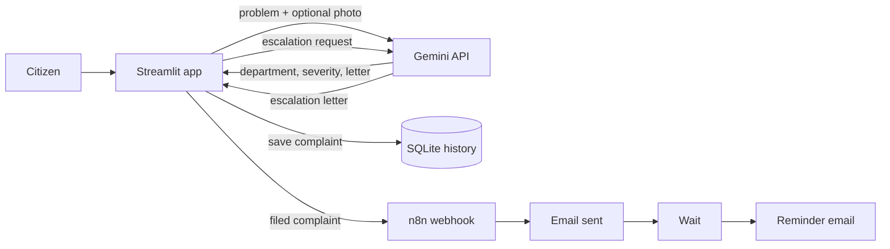

# 📮 Complaint Chaser

> Turn a civic problem into a clear complaint, and follow up until it moves.

**Team POWER DUO** · Forge ’26 (NxtWave Launchpad) · Theme 1: Civic Pulse, Digital Governance & Public Information

🔗 **Live app:** https://complaintchaser.streamlit.app
🎥 **Demo video:** <paste link> · 📊 **Pitch deck:** <paste link>

## The problem
People file a civic complaint (water, garbage, roads, street lights) once, hear nothing back, and give up. Writing a formal complaint in the right words, in the right language, to the right department is hard, and nobody follows up.

**Who it helps:** residents, especially those more comfortable in Telugu or Hindi than in formal English.

## Our solution
Complaint Chaser drafts the complaint, files it, and keeps chasing it.
1. **Describe** the problem in plain words, with the city and an optional photo.
2. **AI drafts** a formal letter in English, Telugu or Hindi, picks the responsible department, and scores severity (1 to 5) with a reason. It also lists possible causes and the roles that normally handle the problem.
3. **Review and choose recipients.** The letter is editable. Official officer emails can be looked up from public web pages (nothing is pre-ticked, and unconfirmed emails are flagged), or the user types an address.
4. **File:** the complaint gets an ID (for example `CF-2026-00001`), is saved to the complaint history, and is emailed through an n8n automation.
5. **Follow up:** n8n waits and sends a reminder email automatically.
6. **Escalate:** the AI drafts a firm escalation letter to a senior officer, and the complaint is marked as escalated.

**Complaint history:** every filed complaint appears as a card with its ID, category, department, a status timeline (Submitted → Under review → In progress → Resolved), an expected-by date, and an escalation badge. Users can search and filter, add follow-up notes, download the letter, escalate, mark a complaint resolved, reopen it if it was not fixed, or withdraw it. History is linked to the phone number or email the user saves, so it survives a page refresh.

**Guardrails:** the AI may only use facts the user gave (placeholders for the rest), asks for details when the input is vague, declines non-civic input, validates email addresses, and every letter is marked for human review before sending.

## Architecture


## Tech stack
Python · Streamlit · Google Gemini API (`google-genai`, with automatic fallback between models) · SQLite · n8n (webhook, email, wait) · Streamlit Community Cloud · GitHub

## Setup
```bash
git clone https://github.com/sanjana30kavuri-lab/Forge-26-First-project-.git
cd Forge-26-First-project-
python -m venv .venv
.venv\Scripts\activate           # Mac/Linux: source .venv/bin/activate
pip install -r requirements.txt
copy .env.example .env           # Mac/Linux: cp .env.example .env, then fill in your keys
python -m streamlit run app.py
```

| Variable | Purpose |
|---|---|
| `GEMINI_API_KEY` | Google AI Studio key |
| `N8N_WEBHOOK_URL` | Production URL of the n8n webhook |

On Streamlit Community Cloud, add the same two values under the app’s **Secrets**.

## n8n workflow
`n8n/complaint-chaser.json` is the exported workflow: Webhook → Send Email → Wait → Reminder Email. Import it in n8n, add your own email credentials, and activate it.

## Limitations and roadmap
- Letters are AI drafts that the user must review.
- Complaint history is stored in SQLite and linked to a saved phone number or email, not a login. The database can reset when the hosted app is redeployed.
- Complaint status is updated by the user. There is no live feed from municipal systems yet.
- Demo emails go to a test inbox, and the wait is shortened for the demo (the “skip the 7-day wait” button is a labelled shortcut).
- Next: OTP login, a hosted database (MongoDB or Supabase), a department directory, official portal integration, WhatsApp and voice input.

## Team
POWER DUO: Sanjana, Abhinav